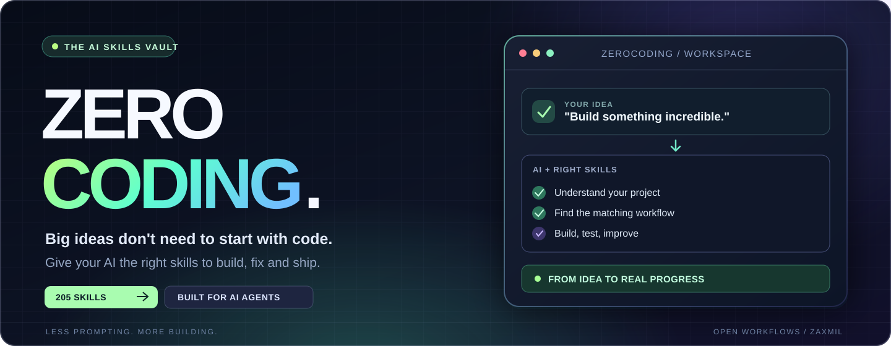
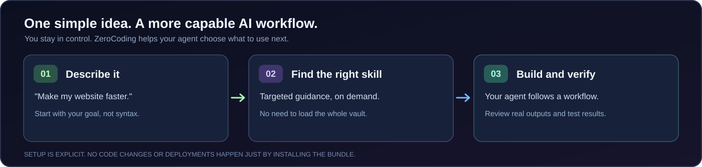

<div align="center">
  

  <br />

  **From “I have an idea” to “I know what to do next.”**

  An organized, reusable collection of **205 AI-agent skills** for building websites, apps, games, automations, designs and more — with a practical way to load only what a task needs.

  <br />

  [](AI_SETUP.md)
  [](SKILLS.md)
  [](agent-skill-bundle/docs/INSTALLATION.md)

  <br />

  [](https://github.com/ZaxMil/ZeroCoding/actions/workflows/agent-bundle-ci.yml)
  [](LICENSE)
  [](SKILLS.md)
  [](https://github.com/ZaxMil/ZeroCoding/stargazers)

  [Get started](#-two-ways-to-start) · [How it works](#-how-zerocoding-works) · [See it in action](#-see-a-skill-in-action) · [Browse skills](#-find-your-skill) · [Safety](#-built-for-control-not-magic)
</div>

---

## ✨ You bring the idea. ZeroCoding brings the playbook.

AI can write code. But the result depends on the **workflow it follows**: how it investigates a problem, designs a solution, tests its changes and checks its work.

**ZeroCoding gives AI coding agents a searchable library of specialized instructions** — from frontend design and debugging to WordPress, security, automation and game development.

<table>
  <tr>
    <td width="50%" valign="top">
      <h3>💡 For people who don't code</h3>
      Describe what you want in everyday language. Give your coding agent the setup link, and let it help you follow a more structured path. <strong>You review what it does.</strong>
    </td>
    <td width="50%" valign="top">
      <h3>🧑‍💻 For developers</h3>
      Keep a large workflow library close at hand without loading every skill at startup. Use project-specific core skills and find specialist guidance when needed.
    </td>
  </tr>
</table>

## 🚀 Two ways to start

### Option A — Tell your AI to set it up

**Best for beginners.** Open your AI coding agent in the project you want to work on, then paste:

```text
Use ZeroCoding to help with my current project:
https://github.com/ZaxMil/ZeroCoding

Read AI_SETUP.md and follow its setup instructions for this
workspace. Check which tools you can actually access,
prepare the skills, and verify the result.

Do not change my application code, install unrelated software,
or deploy anything as part of setup. Explain any blocker clearly.
```

**[Open the AI setup instructions →](AI_SETUP.md)**

> This requires an agent with access to your workspace and an authorized terminal. A chat-only assistant cannot install files on your computer just by reading the link.

### Option B — Install it yourself

**Best for developers.** The documented one-time bootstrap supports **Windows, macOS and Linux**, using Git and GitHub CLI. Review the scripts before running them.

1. **[Follow the installation guide](agent-skill-bundle/docs/INSTALLATION.md)** for your operating system.
2. In each new project, run `agent-setup` to configure the supported skill roots.
3. Check your installation with `agent-init --host all --status`.

`agent-setup` is available **after** machine bootstrap; it is not a built-in operating-system command.

## 🧠 How ZeroCoding works



| What's included | Why it matters |
| :--- | :--- |
| **205 curated skill directories** | A broad source vault with instructions and related resources. |
| **2 global bootstrap skills** | Antigravity can start with a small native entry point rather than the whole vault. |
| **10 project core skills** | Added to supported project skill folders when you explicitly initialize a workspace. |
| **Specialists on demand** | Search the local vault for a relevant skill instead of reading everything at once. |
| **Cross-host project layout** | Documented setup for Antigravity, OpenAI Codex and Claude Code. |

> Skills are **instructions**, not installed applications or a guarantee of identical behavior across AI products. Optional integrations (including the Skill Retrieval MCP server) require separate setup. The local skill-search utility can work without MCP.

## 🎬 See a skill in action

<div align="center">
  <a href="agent-skill-bundle/docs/media/code-motion-reel-preview.mp4">
    
  </a>

  <br />
  <sub><strong>Example output:</strong> a motion-reel workflow. <a href="agent-skill-bundle/docs/media/code-motion-reel-preview.mp4">Watch the MP4 demo</a> · <a href="agent-skill-bundle/creative/code-motion-reel/">Explore the skill</a></sub>
</div>

## 🧩 Find your skill

You don't need to scroll through 205 entries on the homepage. Jump into the category that matches your work:

| **Create & design** | **Build & automate** | **Ship & grow** |
| :--- | :--- | :--- |
| UI/UX and frontend | Coding and architecture | QA, testing and security |
| Animation, visuals and games | n8n and automation | SEO, content and marketing |
| WordPress websites | AI-agent processes | Deployment and operations |

**[Browse the complete searchable-by-page skills catalog →](SKILLS.md)**

You can also inspect the [full source vault](agent-skill-bundle/), [upstream credits](agent-skill-bundle/CREDITS.md) and [contribution guide](agent-skill-bundle/CONTRIBUTING.md).

## 🛡️ Built for control, not magic

- **No silent product edits:** setup is meant to prepare agent workflows, not rewrite your app.
- **No secret or dependency setup by default:** external services, credentials and tools are separate steps.
- **Existing project rules are preserved:** managed setup is designed not to overwrite personal instructions.
- **Cleanup is documented:** `agent-init --remove` removes project-managed entries, not unrelated project files.
- **Verify, don't assume:** agents should report what they actually installed and tested.

Read the [security guidance](agent-skill-bundle/SECURITY.md), [detailed documentation](agent-skill-bundle/README.md) and [installation instructions](agent-skill-bundle/docs/INSTALLATION.md) before running scripts.

---

<div align="center">
  <h3>Stop collecting prompts. Start building with better workflows.</h3>
  <p>
    <a href="AI_SETUP.md"><strong>Get started</strong></a>
    &nbsp; · &nbsp;
    <a href="SKILLS.md"><strong>Explore the vault</strong></a>
    &nbsp; · &nbsp;
    <a href="https://github.com/ZaxMil/ZeroCoding/stargazers"><strong>Star this project</strong></a>
  </p>
  <sub>Made for curious beginners and serious builders. Created by <a href="https://github.com/ZaxMil">ZaxMil</a>. MIT licensed.</sub>
</div>
